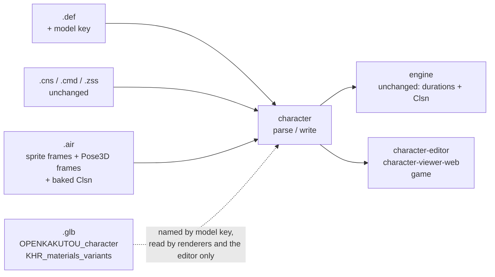

# OpenKakutou 3D character extension

Specification of the OpenKakutou-exclusive 3D character format, version 1. It
implements roadmap decision `028` (`roadmap/.vibe/decisions/028-openkakutou-exclusive-3d-character-format.md`).
`character` is the reference for the character format: `character-editor`,
`character-viewer-web` and `game` implement against this document. This
repository itself only parses and serializes the data described here
(`.def` key, `.air` frames); it never reads glTF and never renders.

🔒 **Compatibility rule.** The extension is strictly additive. Every existing
MUGEN 1.0/1.1 and Ikemen GO file keeps parsing and behaving exactly as before:
nothing below changes the meaning of an existing key, line or file. A 3D
character does not load usefully in MUGEN or Ikemen GO, by design.

## Overview

A character stays split in logic and presentation. Logic (`.cns`, `.cmd`,
`.zss`) is unchanged and reaches visuals only by action number. Only the
presentation layer gains a 3D variant:



The dotted arrow means `character` only records the `.glb` path; it never
opens the file.

## 1. `.def`: the `model` key

`[Files]` gains one optional key:

```
[Files]
model = hero.glb
```

- Path resolution is the same as for `sprite` and `anim`: relative to the
  directory holding the `.def`, backslashes accepted as separators, a
  case-insensitive fallback when no exact match exists.
- The value is a glTF 2.0 binary (`.glb`). External-resource `.gltf` files are
  not part of version 1.
- `model` is optional; when it is present, `sprite` becomes optional too (a
  `.sff` may still exist for sprite-based effects, see section 2).
- A `.def` without `model` is a plain MUGEN/Ikemen GO character, unchanged.

Ikemen GO reads `[Files]` entries by key lookup, so an unknown `model` key is
ignored (`src/char.go:4280-4281` reads `sprite` and `anim` this way, at
Ikemen-GO commit `54d4148a728153c2097a0fb899a06812b2d3e193`). The same is true
of this repository's own `def` parser (`def/parser.go:119`: any other key in
`[Files]` is ignored). MUGEN: not verified.

## 2. `.air`: the `Pose3D` frame

A frame is either a sprite frame (unchanged) or a 3D pose frame. Both kinds
may appear in the same action, so hit sparks, `Explod`s and projectiles can
stay sprite-based while the body is 3D.

### Syntax

```
Pose3D: <clip>, <tick>, <duration>
```

| Field | Meaning |
|---|---|
| `<clip>` | Name of a glTF animation (`animations[].name`) of the character's `.glb`. Non-empty, no comma, matched case-sensitively after trimming surrounding spaces. |
| `<tick>` | Position in the clip, in game ticks (1 tick = 1/60 s), integer ≥ 0. The pose is the clip sampled at `tick / 60` seconds; a tick past the clip's end holds its last pose. |
| `<duration>` | How long the frame lasts, in ticks, exactly as the `Time` field of a sprite frame: an integer ≥ 1, or `-1` for "forever". |

Rules:

- The keyword `Pose3D` is case-insensitive, whitespace around the colon and the
  commas is ignored, and `;` starts a comment as in the rest of `.air`.
- Exactly three fields. A `Pose3D` line with another number of fields, a
  non-integer `tick` or `duration`, a negative `tick`, or a `duration` of 0 or
  below -1, is an error. There is no flip or blend field: facing is a rotation
  (section 5) and blending is not part of version 1.
- A `Pose3D` line is a frame: it counts for `Loopstart`, for the action's total
  time, and for `Clsn1:`/`Clsn2:` blocks (a bare block applies to the next
  frame line, `Clsn1Default:`/`Clsn2Default:` to every frame without its own),
  exactly as a sprite frame does. Baked collision boxes (decision `028`, point
  3) are therefore written before the `Pose3D` line they belong to.
- `Interpolate` directives apply to sprite frames only.

### Why this syntax

Both Ikemen GO and the existing `air` parser read a frame line as
`Group,Image,X,Y,Time[,...]`; a 3D frame must never be misread as one.

- **Ikemen GO** only treats a line as a frame when it starts with a digit or
  `-` (`src/anim.go:45-48`, `ReadAnimFrame` returns no frame and no error
  otherwise). Lines are lower-cased before matching (`src/anim.go:356-357`,
  `readAnimation`), and the only keywords it recognizes are the prefixes
  `copy action `, `loopstart`, `interpolate offset|scale|angle|blend` and
  `clsn` (`src/anim.go:360-405`). `pose3d: ...` starts with a letter and
  matches none of them, so Ikemen GO skips the line without any error. The
  keyword for any future line of this family must keep avoiding those prefixes.
  Verified by reading the source above (commit
  `54d4148a728153c2097a0fb899a06812b2d3e193`); not run.
- **MUGEN 1.0/1.1**: not verified. Its source is closed and its documentation
  does not say how a non-frame line inside an action is treated. The only
  related evidence is indirect: real MUGEN characters carry unrecognized
  content lines inside `.air` files (the `:`-prefixed lines of the "Mai (98)"
  character are kept working by the existing parser, see `air/parser.go`
  `stripComment` and the `:` branch of `Parse`, backlog item 054). Confirming
  the behavior takes loading a sample character in MUGEN 1.1.
- **This repository's `air` parser** currently rejects a `Pose3D` line (it
  expects five fields). Teaching it the line is backlog item 070.

Consequence for a sprite-only engine: a 3D action has fewer frames (the
`Pose3D` ones are skipped), which is acceptable since such a character is not
meant to run there. One interaction is worth knowing: Ikemen GO keeps a
`Clsn` block waiting until the next frame it recognizes, so boxes written for a
`Pose3D` line would attach to the next *sprite* frame of the action in Ikemen
GO. Again irrelevant outside OpenKakutou.

### Mixed example

```
[Begin Action 200]
Clsn2Default: 1
 Clsn2[0] = -12, 0, 12, -70
Clsn1: 1
 Clsn1[0] = 8, -62, 46, -48
Pose3D: kick_light, 0, 2
Pose3D: kick_light, 2, 3
Pose3D: kick_light, 5, 4
0,1, 0,0, 3         ; sprite frame: a spark drawn from the character's .sff
Pose3D: kick_light, 9, 6
```

## 3. glTF vendor extension `OPENKAKUTOU_character`

The `.glb` declares the extension in the root `extensionsUsed` and carries one
object in the root `extensions`:

```json
{
  "extensions": {
    "OPENKAKUTOU_character": {
      "version": 1,
      "scale": 96,
      "groundOrigin": [0, 0, 0],
      "rootBone": "Hips"
    }
  }
}
```

| Property | Type | Meaning |
|---|---|---|
| `version` | integer | Always `1` here. A reader that does not know the value refuses the model. |
| `scale` | number, finite, > 0 | Character-space units per glTF unit. Character space is the one of `.air` offsets and `Clsn` boxes (before the `.def` `[Size]` scaling, which applies to a 3D model as it does to sprites). With a model authored in metres, `scale` 96 makes a 1.75 m model about 168 units tall. |
| `groundOrigin` | array of 3 finite numbers `[x, y, z]` | The point of the model, in glTF units, placed at the character's position on the stage floor: its `x` and `z` define the character's vertical axis, its `y` the floor height. |
| `rootBone` | string | Name of the glTF node that is the root of the skeleton. |

Space conventions (glTF is right-handed and Y-up):

- A character with facing `+1` looks toward the model's **+X**. The fight plane
  is the model's X–Y plane; Z is depth, toward the viewer. Renderers use an
  orthographic projection along Z.
- Character space has Y pointing down (as in `.air`); the model's Y points up,
  so the vertical axis is flipped when going from one to the other.
- Movement belongs to the state machine, not to the clip: a renderer discards
  the X and Z translation of `rootBone` in every clip (its Y translation and
  all rotations are kept), and positions the model so that `groundOrigin`
  lands on the character's position.

## 4. Palettes: `KHR_materials_variants`

Palette slots map to material variants through the ratified glTF extension
`KHR_materials_variants`:

- Palette slot *N* (the *N* of `palN` in `[Files]`, counting from 1) selects
  the variant whose `name` is `palN`, compared case-insensitively.
- A slot with no matching variant renders the model's default materials.
- The model's default materials are the look of slot 1 when no `pal1` variant
  exists.
- `palN` entries in `[Files]` keep their meaning for the character's sprites
  (effects drawn from its `.sff`); they are independent of the model's
  variants.

Palette selection at character select therefore works unchanged: the same slot
number drives the sprites and the model.

## 5. Facing: a 180° rotation, never a mirror

When the character's facing is `-1`, the model is rotated 180° around the
vertical axis through `groundOrigin` (`x`, `z`). It is never mirrored: a
mirrored model swaps handedness, so a left-handed stance would turn right-handed.

Collision boxes stay exact. Take a point `(x, y, z)` and rotate it by 180°
around the vertical axis through `(a, c)`: it becomes `(2a − x, y, 2c − z)`.
Projected on the fight plane (dropping Z), that is `(2a − x, y)`, the mirror of
the unrotated projection `(x, y)` about the vertical line `x = a`. With `a` the
character's axis, this is precisely how `Clsn` boxes are already mirrored for
facing `-1`; no per-facing bake is needed and `engine` is unchanged.

## 6. Standard actions

Custom states (`ChangeAnim`, `ChangeAnim2`, `p2stateno`) and the common states
work unchanged, because they select visuals by action number. For a 3D
character to fight a sprite character, and the reverse, it must provide the
standard actions as 3D poses (or sprites: either kind satisfies the engine,
which only reads durations and `Clsn` boxes) exactly as a sprite character
provides them as sprites.

The action numbers the common states switch to, read from Ikemen GO's
`data/common1.cns.zss` at commit `54d4148a728153c2097a0fb899a06812b2d3e193`
(`anim:` in `StateDef` headers, `changeAnim` calls, and the base numbers its
helpers add an offset to). Action numbers, not state numbers: state 52, for
example, plays action 47.

| Actions | Used for |
|---|---|
| 0, 10-12, 20, 21 | stand, crouch transition, crouch, walk |
| 40-47 | jump start, jump, landing |
| 100, 105 | run forward, hop back |
| 110, 115, 120, 130-132, 140, 150-152 | guard and guard hit |
| 170, 175, 190 | lose, draw, intro poses |
| 5000-5002, 5010-5012, 5020-5022 | get hit (stand, crouch, air) |
| 5030, 5035, 5040, 5050, 5051-5059 | air get hit, falling, recovery |
| 5070, 5080, 5090, 5100, 5110, 5120, 5140, 5160, 5170 | trip, bounce, lying down, getting up, knocked out |
| 5200, 5210, 5300, 5500 | other common reactions |

Actions 5 (turn) and 6 (crouch turn) are only tested, never requested: a
character plays them if it has them. This list is what Ikemen GO's common
states request; MUGEN 1.0/1.1's own common states may request others (not
verified here). A missing action is handled exactly as it already is for a
sprite character.

## 7. Complete example

`hero.def`:

```
[Info]
name = "Hero"

[Files]
cmd = hero.cmd
cns = hero.cns
st = hero.cns
anim = hero.air
model = hero.glb
pal1 = hero_pal1.act   ; palette of the effects drawn from the .sff
sprite = effects.sff
```

`hero.air` (excerpt):

```
[Begin Action 0]
Clsn2Default: 1
 Clsn2[0] = -12, 0, 12, -70
Pose3D: idle, 0, 6
Pose3D: idle, 6, 6
Pose3D: idle, 12, 6
Pose3D: idle, 18, 6

[Begin Action 5000]
Clsn2Default: 1
 Clsn2[0] = -12, 0, 12, -70
Pose3D: hit_stand_light, 0, 3
Pose3D: hit_stand_light, 3, 3
0,2, 0,-70, 3           ; sprite frame: impact flash from effects.sff
```

`hero.glb`, root extensions (JSON excerpt):

```json
{
  "extensionsUsed": ["OPENKAKUTOU_character", "KHR_materials_variants"],
  "extensions": {
    "OPENKAKUTOU_character": {
      "version": 1,
      "scale": 96,
      "groundOrigin": [0, 0, 0],
      "rootBone": "Hips"
    },
    "KHR_materials_variants": {
      "variants": [{ "name": "pal1" }, { "name": "pal2" }]
    }
  },
  "animations": [{ "name": "idle" }, { "name": "hit_stand_light" }]
}
```
